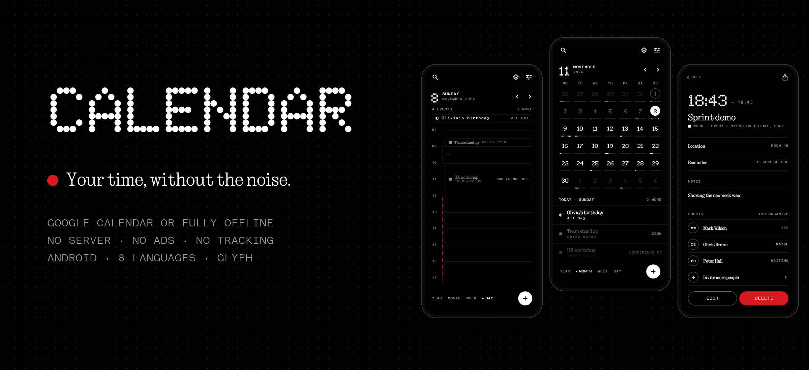
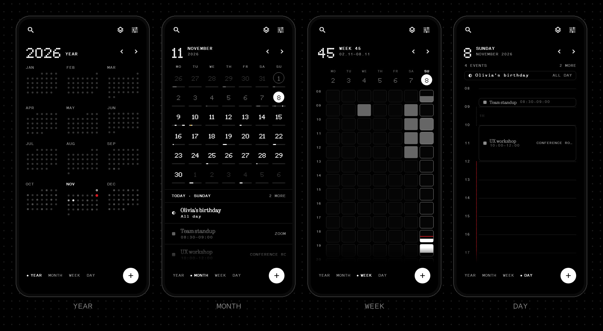
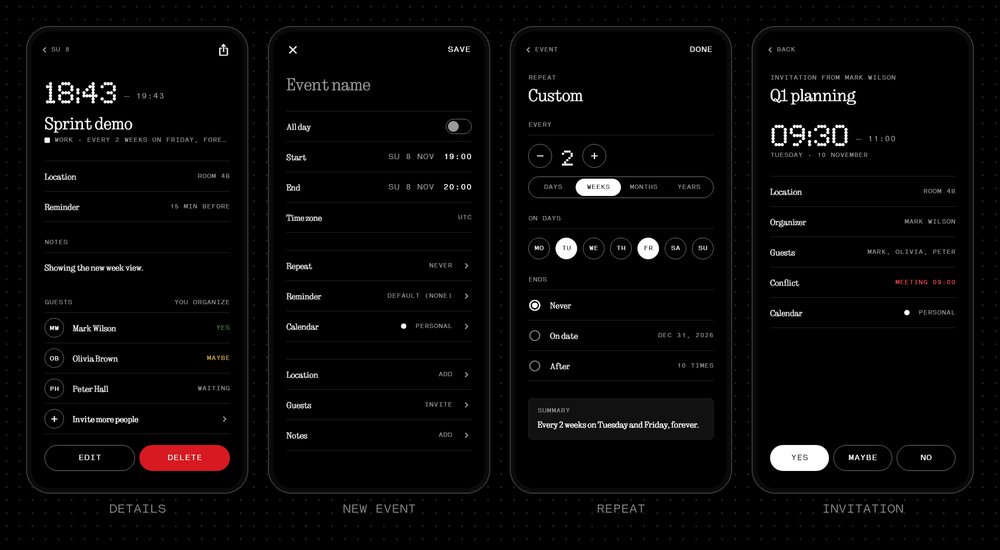
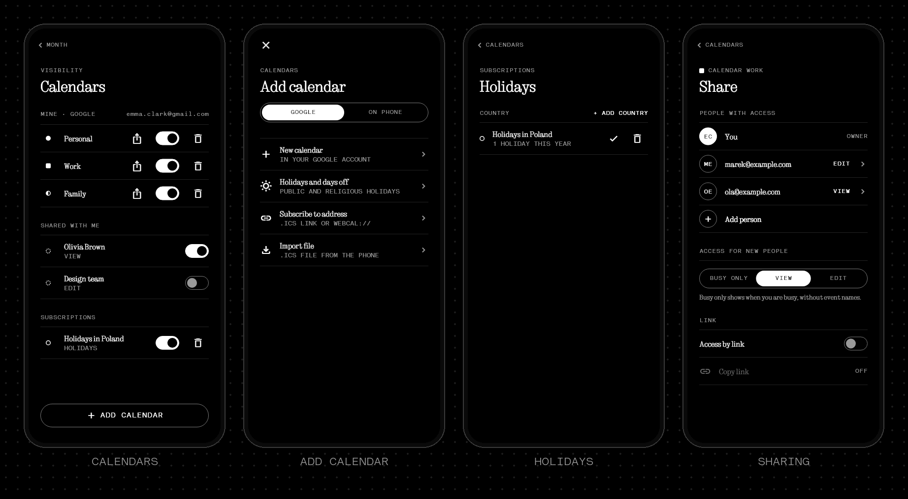
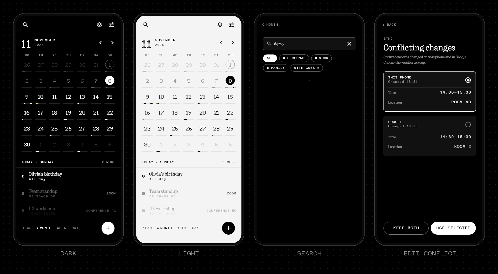
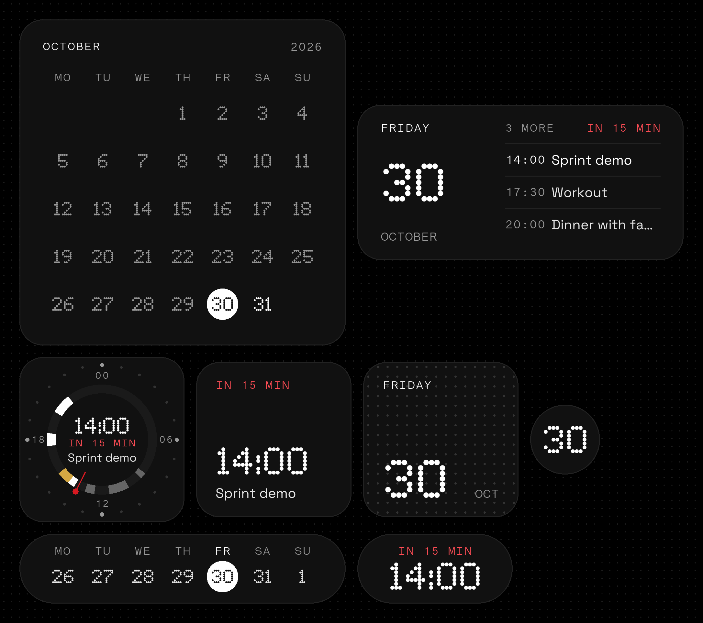
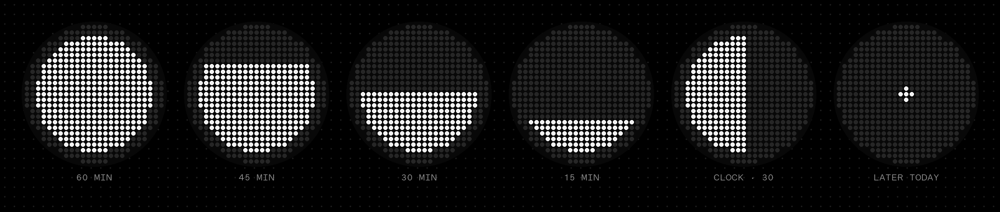
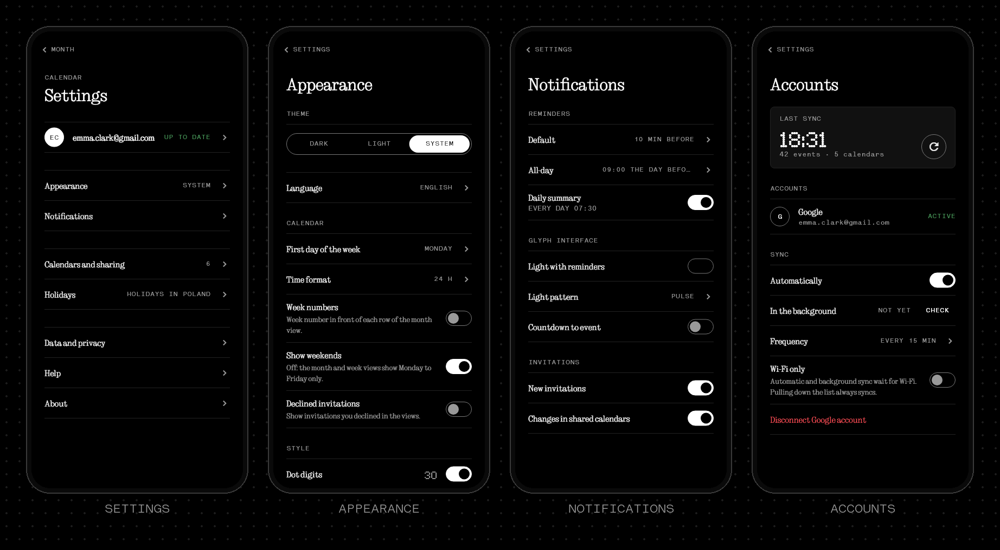
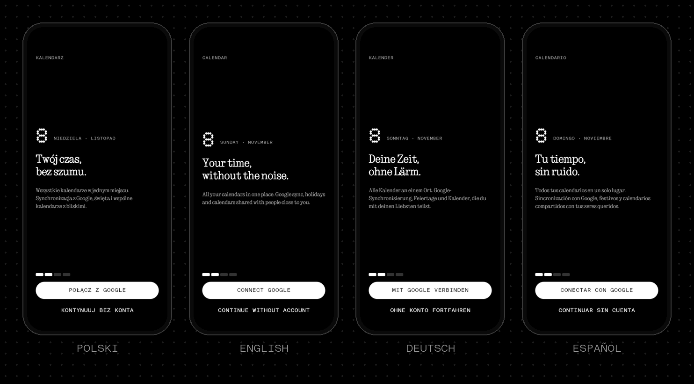
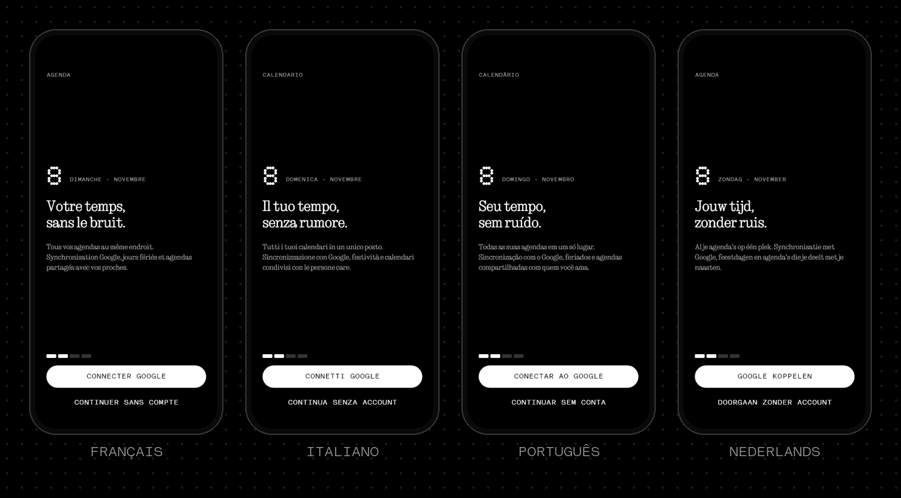

<p align="center">
  
  
  
  
  
  
</p>

**Calendar** is a quiet Android calendar in the spirit of Nothing's design: black and white, dot-matrix numbers and
shapes instead of colours. Sign in with Google and it syncs straight from your phone, or skip the account and keep
everything on the device. Either way there is no server in between, no ads and no tracking.

<table>
  <tr>
    <td width="33%" valign="top"><b>Two ways to use it</b><br>Google Calendar sync, calendars kept only on the phone, or both side by side.</td>
    <td width="33%" valign="top"><b>Made for Nothing phones</b><br>Glyph lights for reminders and a countdown on the matrix, widgets in the same style.</td>
    <td width="33%" valign="top"><b>Private by design</b><br>No backend: events travel only between your phone and Google.</td>
  </tr>
</table>

## Four views, one look



- **Year** at a glance, **month** with the day's agenda under it, **week** as a time grid, **day** with free time
  between events and a red line for "now".
- Calendars are told apart by **24 marker shapes**, holidays by a ring around the date.
- Dot-matrix digits, past events dimmed, week numbers, weekends on or off, 24 h or 12 h.
- Tap a view tab twice to jump back to today; swipe or use the arrows to move through time.

## Events, the way Google Calendar does them



- All-day or timed, with location, notes, reminders and the time zone.
- **Repeats** every N days, weeks (on chosen days), months or years, until a date or N times. Changes and deletions
  ask "only this", "this and following" or "all".
- **Guests**: invite people, see who said yes, maybe or no, and answer invitations, with clashes pointed out.
- If the event was changed in Google while you were editing it, you choose which version to keep.

## Calendars from anywhere



- **Google**: your calendars, calendars shared with you and subscriptions. Share a calendar with people or by link,
  with busy-only, view or edit access.
- **On this device**: calendars that never leave the phone, with or without a Google account, including repeats.
- **Holidays** for 244 countries, **address subscriptions** (`.ics` / `webcal://`, refreshed hourly) and `.ics`
  **import and export**.

## Dark, light and everything in between



Dark and light themes (or follow the phone), **search** across titles, places, guests and calendars that also works
offline, and a clear choice when the same event was edited in two places.

## Widgets



Eight home screen widgets in dark and light: month, today, week, next event, date in two sizes and a **24 h day clock**
with the day's events around the dial. Every widget counts down the next event at 60, 45, 30 and 15 minutes.

## Glyph Interface



On Nothing phones with Glyph lights:
- **Light with reminders** in a pulse, blink or steady pattern.
- **Countdown to an event**: the light strip shows the time left for 5 seconds at 60, 45, 30 and 15 minutes
  (every 10 minutes on Phone (4a)), and every light blinks when the event starts.
- **Glyph Toy for the matrix** (Phone (3), Phone (4a) Pro): a circle that empties like a glass, or like a clock hand,
  as the event gets closer, and a small plus while there is still something later today.

## Settings



Reminders, a daily summary and invitation notifications (with "snooze 5 min"), app lock with your fingerprint, face
or screen lock code, background sync on a schedule (optionally only on Wi-Fi) and an offline cache, so the app opens
instantly.

## Eight languages




Polski, English, Deutsch, Español, Français, Italiano, Português and Nederlands. Pick one on the first screen or later
in Appearance, or let the app follow the phone.

## Privacy

- No server, no ads, no analytics, no tracking.
- With Google the app asks for your events, the calendar list, invitation replies and the account's e-mail address,
  and nothing else: no mail, Drive, photos or contacts.
- What the app keeps (a cache of events, calendars on this device, settings) stays in the app's storage on the phone.
  "Clear data" or uninstalling removes it; Google access can be revoked at
  [myaccount.google.com/permissions](https://myaccount.google.com/permissions).

## Build it yourself

Requirements: Flutter 3.47 (Dart 3.13), the Android SDK and JDK 17.

1. **Typefaces.** The design's three typefaces are not part of this repo, as their licences do not clearly allow
   sharing them. Download them into `assets/fonts/` (the build stops with a clear message while one is missing):
   [Ndot57-Regular.otf](https://github.com/xeji01/nothingfont/raw/main/fonts/Ndot57-Regular.otf) ·
   [NType82-Regular.otf](https://github.com/xeji01/nothingfont/raw/main/fonts/NType82-Regular.otf) ·
   [LetteraMonoLL-Regular.otf](https://github.com/xeji01/nothingfont/raw/main/fonts/LetteraMonoLL-Regular.otf)
2. **Glyph lights (optional, Nothing phones).** Put `glyph-matrix-sdk-2.0.aar` from Nothing's
   [Glyph Developer Kit](https://github.com/Nothing-Developer-Programme/Glyph-Developer-Kit) (folder `sdk/`) into
   `android/app/libs/`. Without it the app builds the same, only without Glyph lights.
3. **Google (optional).** Create a Google Cloud project with the Calendar API and two OAuth clients, Android and web,
   as described in [docs/GOOGLE.md](docs/GOOGLE.md), and put the web client ID in `config.json` at the repo root
   (git-ignored):
   ```json
   { "GOOGLE_SERVER_CLIENT_ID": "1234567890-abc.apps.googleusercontent.com" }
   ```
   Without it the app works with calendars on the device only (leave out `--dart-define-from-file` below).
4. **Signing.** Use your own key in `android/key.properties` (git-ignored, see [docs/WORKFLOW.md](docs/WORKFLOW.md));
   its SHA-1 must match the Android OAuth client.
5. **Build:**
   ```bash
   flutter build apk --release --split-per-abi --dart-define-from-file=config.json
   ```

## Inside the project

| | |
|---|---|
| Design | [docs/design/mockup.html](docs/design/mockup.html) (33 screens) · [views.html](docs/design/views.html) · [DESIGN.md](docs/DESIGN.md) |
| State and plans | [STATUS.md](docs/STATUS.md) · [TODO.md](docs/TODO.md) · [CHANGELOG.md](CHANGELOG.md) |
| Code and decisions | [ARCHITECTURE.md](docs/ARCHITECTURE.md) · [DECISIONS.md](docs/DECISIONS.md) |
| Branches, versions, builds | [WORKFLOW.md](docs/WORKFLOW.md) |

Versions are dates (`2026.11.08`). Work happens on `dev`; releases go to `main`. The screenshots above are rendered by
the app's own tests and laid out by [tool/readme_images.py](tool/readme_images.py).

## License

[GPL-3.0](LICENSE). You may use, study, change and share the code; if you share a changed version, its source has to
be open under the same licence.

The typefaces (Ndot 57, NType82, Lettera Mono) and Nothing's Glyph Developer Kit are not part of this repo and not
covered by this licence; Space Mono and Space Grotesk, which fill in the letters the design's typefaces lack, are under
the SIL Open Font License.

## Credits

Typefaces from the design: Ndot 57 and NType82 (Nothing) and Lettera Mono (Lineto), with Space Mono and Space Grotesk
(Colophon, for Google Fonts). Glyph lights through Nothing's Glyph Developer Kit. Not affiliated with Google or
Nothing.
